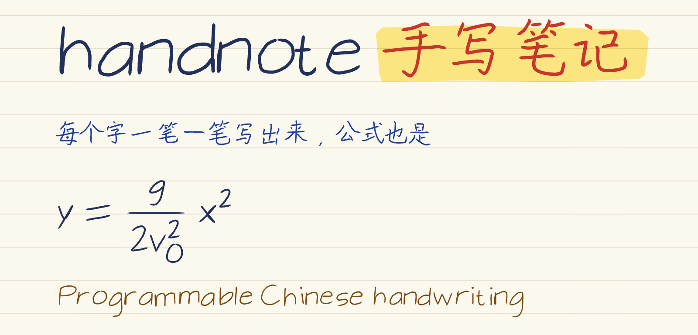
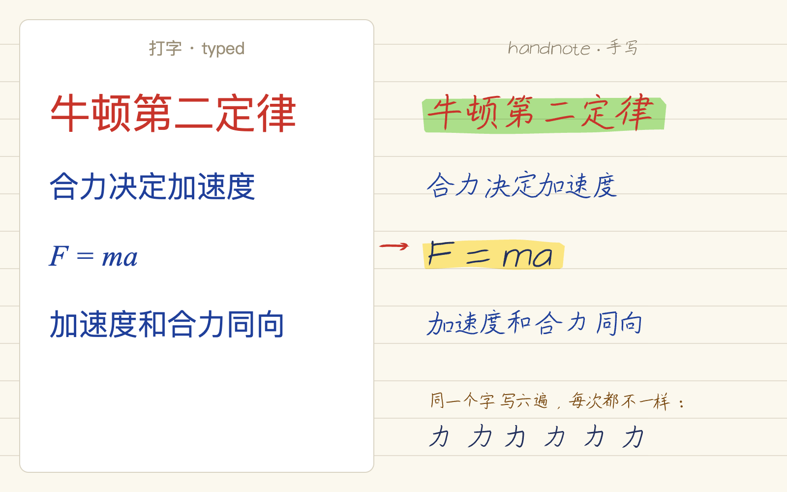
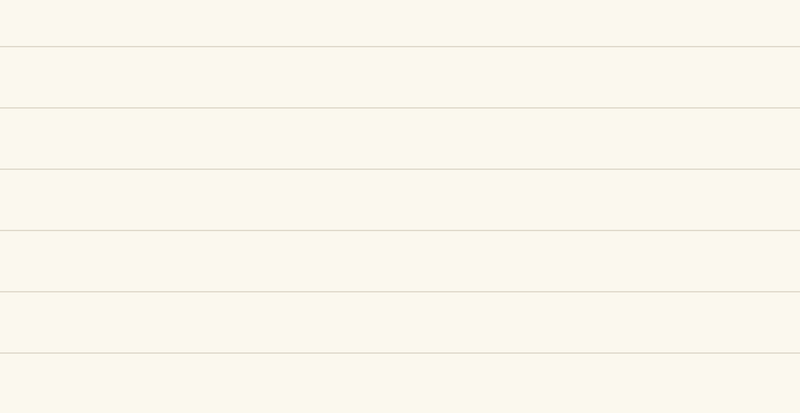
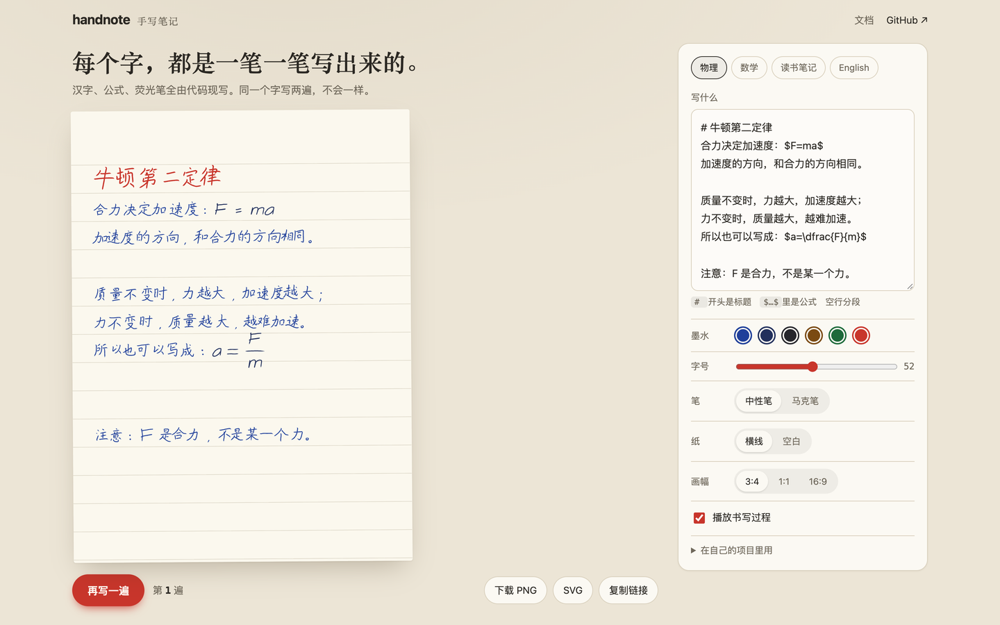
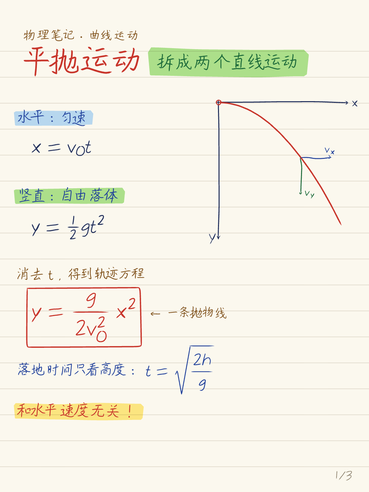
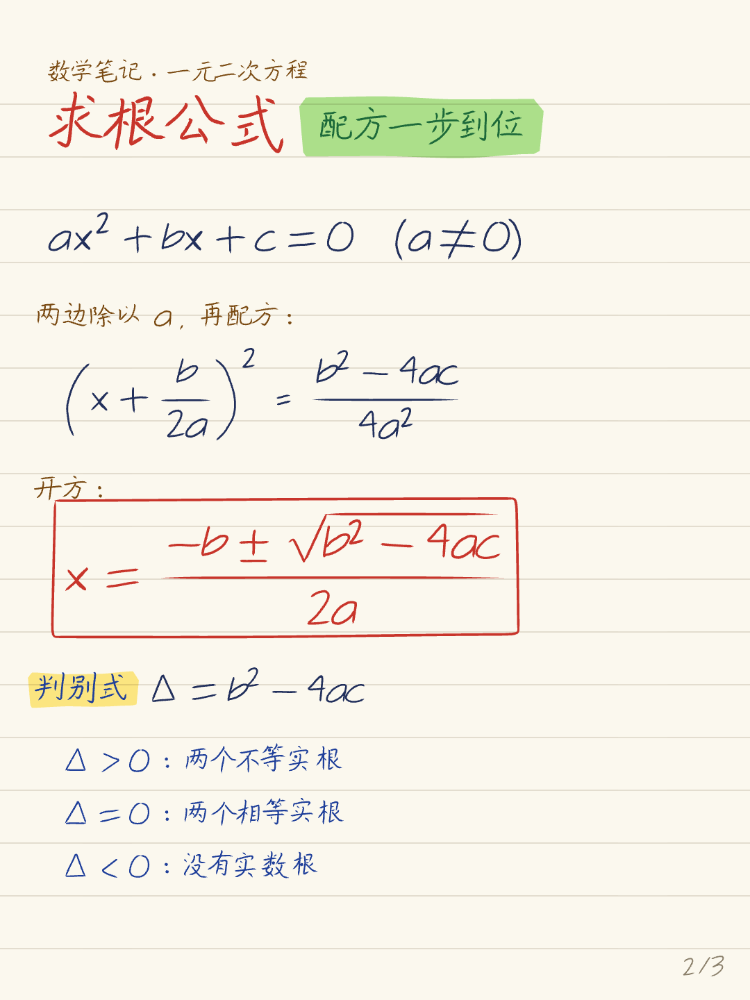
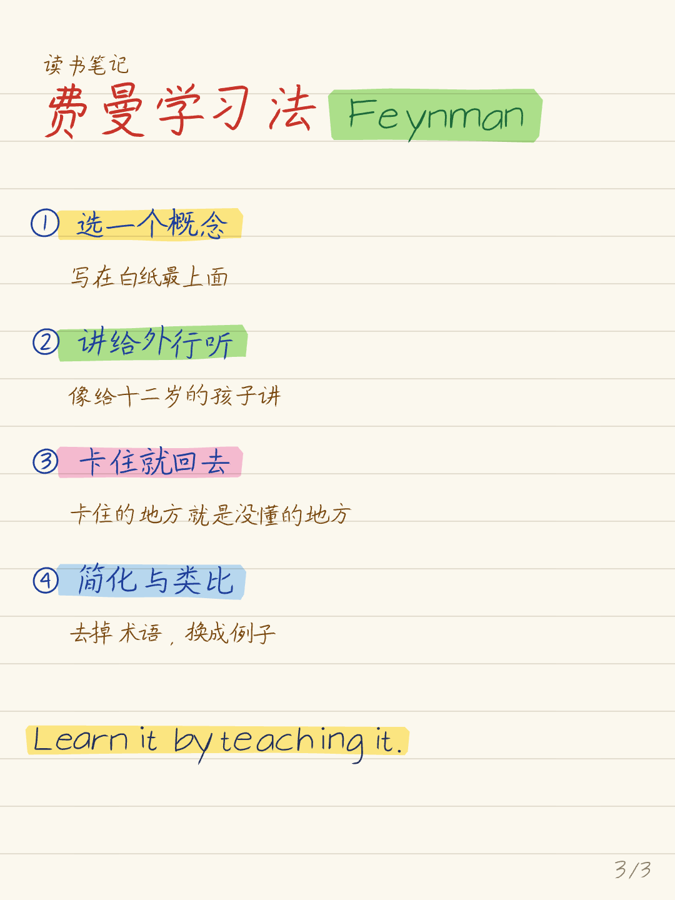

<p align="center">
  <picture>
    <source media="(prefers-color-scheme: dark)" srcset="docs/images/banner-dark.png">
    
  </picture>
</p>

<p align="center"><b>Write genuinely handwritten Chinese notes in code — characters, formulas, highlighter, all drawn stroke by stroke.</b></p>

<p align="center">
  <a href="https://rayw-lab.github.io/handnote/playground/">Playground</a> ·
  <a href="README.md">中文</a> ·
  <a href="#quick-start">Quick start</a> ·
  <a href="#for-agents">For agents</a>
</p>

<p align="center">
  <a href="LICENSE"></a>
  =18" src="https://img.shields.io/badge/node-%3E%3D18-3c873a">
</p>

<p align="center"></p>

## Why not just a handwriting font?

In a handwriting font, every “的” is pixel-identical — the illusion dies at the second occurrence. handnote doesn't use a font at all. It fetches each character's **stroke medians** and then:

- **Every stroke jitters on its own**: starts taper off a little, ends overshoot a touch, wavers along its normal with low-frequency hand tremor — and the whole character gets a dash of scaling, rotation, slant, and baseline drift. Two “力” on the same page are never the same.
- **Ink follows pen pressure**: [perfect-freehand](https://github.com/steveruizok/perfect-freehand) simulates how a gel pen or marker gets thicker and thinner.
- **Formulas are handwritten too**: MathJax does the typesetting (where fractions, radicals, and sub/superscripts go), then every glyph is swapped for hand-drawn strokes. The fraction bar is drawn by hand; so is the radical.
- **Reproducible**: the same `seed` yields the same SVG, byte for byte; change the seed and the page is “written again”.
- **It can write live**: stroke order is recorded, so you can export a write-on animation (GIF / MP4) — and iPhone Live Photos.

<p align="center"></p>

## Quick start

```bash
npm install github:rayw-lab/handnote
npx playwright install chromium     # first run only: the CLI renders through headless Chromium

# one line, one page (# starts a title, $…$ is math, lines wrap automatically)
npx handnote write "# 牛顿第二定律\n合力决定加速度：\$F=ma\$" -o note.png
# ("Newton's second law — net force sets acceleration: F=ma")

# multi-page notes: copy the example page module, edit, render
cp node_modules/handnote/examples/notes.js my-notes.js
npx handnote render my-notes.js -o out/

# write-on animation (needs ffmpeg); on macOS add --live-photo <dir> for an iPhone Live Photo
npx handnote animate --text "# 手写\n每一笔都是现写的" -o write.gif
npx handnote animate my-notes.js --page 2 --all -o page2.mp4
```

Use it straight in a web page (no build step; data loads from jsDelivr):

```html
<script type="importmap">
{ "imports": {
  "handnote": "https://cdn.jsdelivr.net/gh/rayw-lab/handnote@main/src/index.js",
  "perfect-freehand": "https://cdn.jsdelivr.net/npm/perfect-freehand@1.2.3/dist/esm/index.mjs"
} }
</script>
<div id="page"></div>
<script type="module">
  import { createNote } from 'handnote';
  const note = createNote({ seed: 7 });
  // "Projectile motion: constant horizontal velocity, free fall vertically"
  await note.write('# 平抛运动\n水平匀速，竖直自由落体：$y=\\tfrac12 gt^2$');
  document.getElementById('page').innerHTML = note.toSVG();
</script>
```

## Playground

Nothing to install: [rayw-lab.github.io/handnote/playground](https://rayw-lab.github.io/handnote/playground/). Edit the text, switch ink and pen, hit “再写一遍” (write it again) to see the same words in a new hand, then download PNG / SVG.

<p align="center"><a href="https://rayw-lab.github.io/handnote/playground/"></a></p>

## Examples

<p align="center">
  
  
  
</p>

All three pages live in [`examples/notes.js`](examples/notes.js) — the coordinates and technique are easy to read at a glance. A page module exports a `PAGES` array; each page is an `async (c) => {}`:

| Method | What it does |
|---|---|
| `c.T(text, x, y, size, color)` | Write a line of text by hand (y is the baseline) |
| `c.M(TeX, x, y, size, color)` | Hand-write a formula |
| `c.L(['text', {m: 'TeX'}], x, y, size)` | One mixed line of text and formulas |
| `c.hl(x0, x1, yCenter, height, color)` | One highlighter swipe |
| `c.titleRow(title, chip)` | Big red title + green highlighted tag |
| `c.answerBox(result)` | Draw a box around the answer, by hand |
| `c.sketch(name, {svg, bbox})` | Drop in a hand-drawn sketch (`handStroke` / `handArrow` / `handCircle`) |
| `c.live()` | Strokes written afterwards appear live in the animation |

Rendering ships with an **overlap / out-of-bounds check**: whenever two blocks of ink have intersecting bounding boxes, or anything spills past the page edge, the command lists the offenders and exits with code 3 (the image is still written, so you can see what's colliding where).

## For agents

Send this to Claude Code / Codex:

> Install the handnote skill for me: `npx skills add rayw-lab/handnote`, then turn my notes into a handwritten image.

The skill lives in [`skills/handnote/SKILL.md`](skills/handnote/SKILL.md): the agent uses `handnote write` for a single page, or writes a page module to lay out several pages, then reads the overlap-check output and nudges positions on its own.

## What it supports

- Chinese characters: 9,000+ common characters (Simplified and Traditional) from hanzi-writer-data. Rare characters and emoji are skipped with a note.
- Latin letters, digits, common punctuation and symbols, Greek letters, ①–⑨, Ⅰ Ⅱ.
- Math: MathJax lays out the TeX; fractions, radicals, sub/superscripts, vector arrows, ± ≤ ≥ ≈ ≠ ∞ and common Greek letters are redrawn as handwriting. A symbol *inside a formula* with no hand-drawn glyph yet stops with a clear `No glyph for …` error (plain-text characters are skipped instead) — open an issue and it's usually a few lines to add.
- Paper: lined or blank; any page size (default 1080×1440, 3:4 portrait).

## License

handnote's code is [MIT](LICENSE). The repo **bundles no fonts and no stroke data**: Chinese strokes come from [hanzi-writer-data](https://github.com/chanind/hanzi-writer-data) (derived by Make Me a Hanzi from Arphic fonts, under the Arphic Public License), and the Latin single-line font is EMS (SIL OFL) — both installed as dependencies. See [NOTICE.md](NOTICE.md) for the details.

So this is not an “original font” — it's a machine that writes. The glyph skeletons come from open data; how the hand trembles, how the ink flows, and how a formula gets taken apart — that part is handnote's own.
