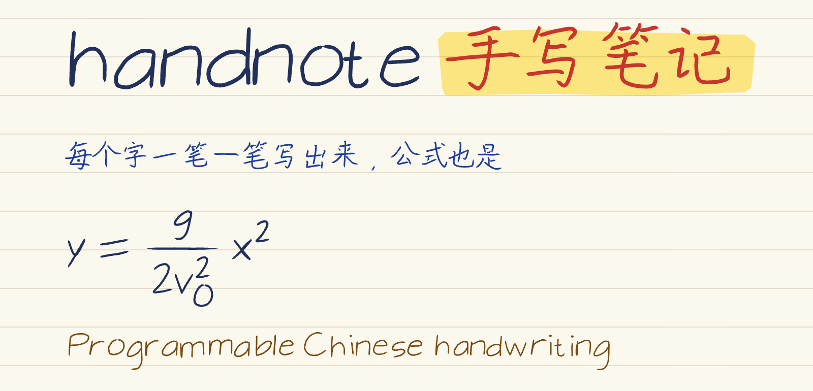
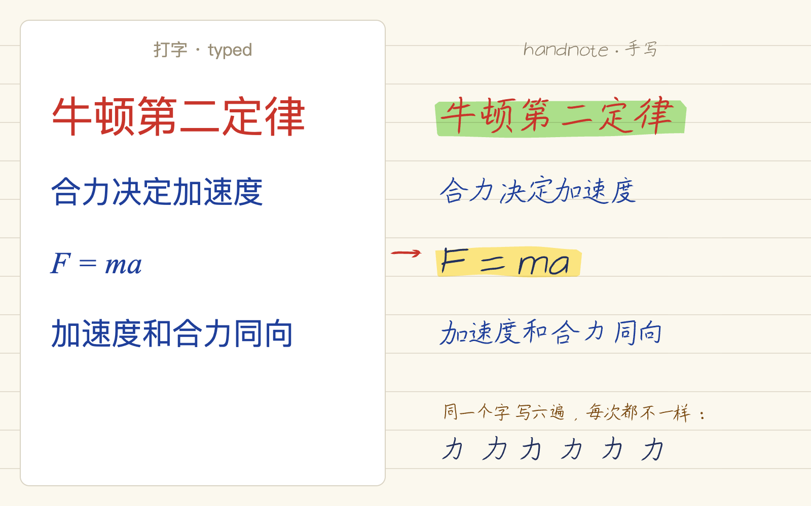
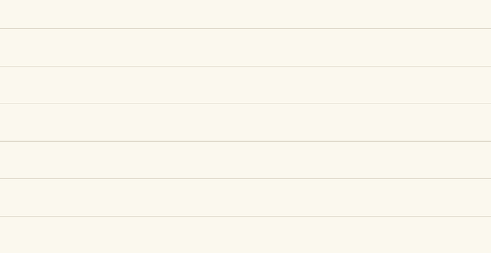
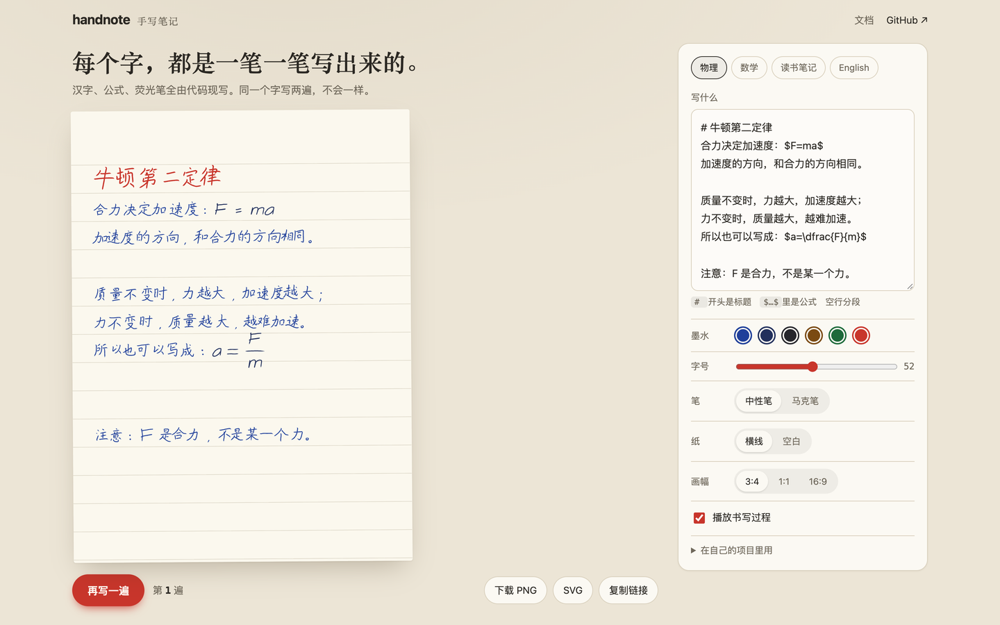
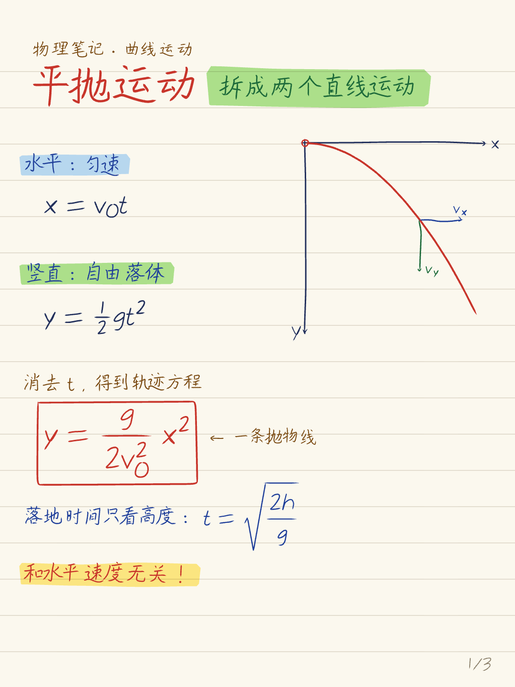
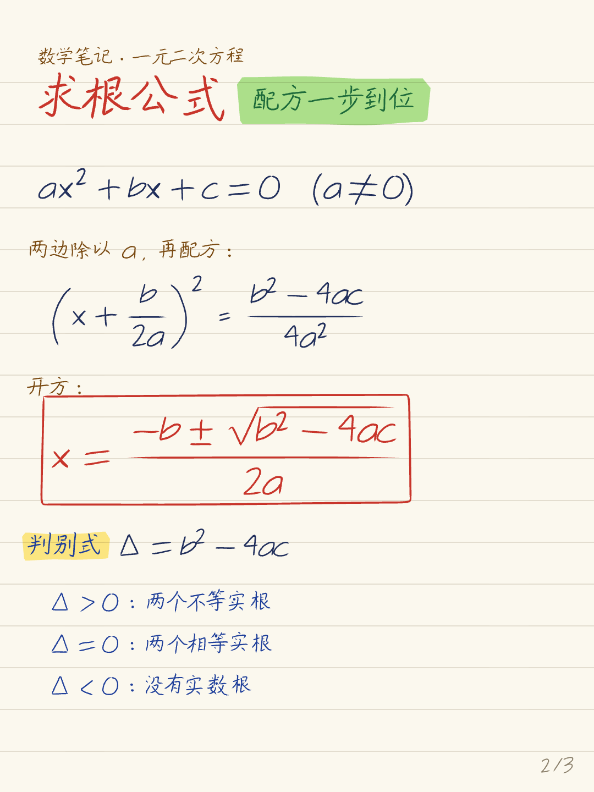
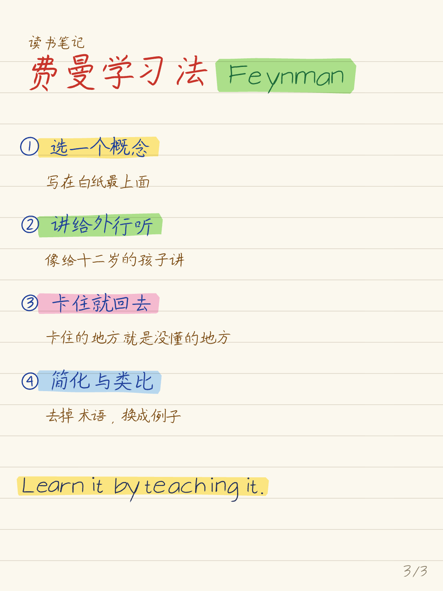

<p align="center">
  <picture>
    <source media="(prefers-color-scheme: dark)" srcset="docs/images/banner-dark.png">
    
  </picture>
</p>

<p align="center"><b>用代码写一页真正“手写”的中文笔记，汉字、公式、荧光笔都是一笔一笔写出来的。</b></p>

<p align="center">
  <a href="https://rayw-lab.github.io/handnote/playground/">在线试玩</a> ·
  <a href="README.en.md">English</a> ·
  <a href="#快速开始">快速开始</a> ·
  <a href="#给-agent-用">给 Agent 用</a>
</p>

<p align="center">
  <a href="LICENSE"></a>
  =18" src="https://img.shields.io/badge/node-%3E%3D18-3c873a">
</p>

<p align="center"></p>

## 它和“手写字体”有什么不同

手写字体里每个“的”都长一样，一眼就假。handnote 不用字体，它拿到每个汉字的**笔画中线**，然后：

- **每一笔单独抖**：起笔稍收、收笔稍冲出，笔画沿法向低频手抖，整个字再有一点缩放、旋转、斜体和基线漂移。同一页里两个“力”永远不一样。
- **按笔压出墨**：用 [perfect-freehand](https://github.com/steveruizok/perfect-freehand) 模拟中性笔、马克笔的粗细变化。
- **公式也是手写的**：MathJax 负责排版（分式、根号、上下标放哪），再把每个字符换成手写笔画。分数线是手画的，根号也是。
- **可复现**：同一个 `seed` 逐字节出同一张 SVG；换个 seed 就是“再写一遍”。
- **能现写**：每一笔的书写顺序都记录了，可以导出“一笔一笔写出来”的动画（GIF / MP4），以及 iPhone 实况照片。

<p align="center"></p>

## 快速开始

```bash
npm install github:rayw-lab/handnote
npx playwright install chromium     # 第一次需要：命令行用无头浏览器出图

# 一行写一页（# 开头是标题，$…$ 之间是公式，自动折行）
npx handnote write "# 牛顿第二定律\n合力决定加速度：\$F=ma\$" -o note.png

# 多页笔记：复制一份示例页面模块，改完渲染
cp node_modules/handnote/examples/notes.js my-notes.js
npx handnote render my-notes.js -o out/

# 一笔一笔写出来的动画（需要 ffmpeg）；macOS 上加 --live-photo <目录> 还能出 iPhone 实况照片
npx handnote animate --text "# 手写\n每一笔都是现写的" -o write.gif
npx handnote animate my-notes.js --page 2 --all -o page2.mp4
```

在网页里直接用（不需要构建，数据走 jsDelivr）：

```html
<script type="importmap">
{ "imports": {
  "handnote": "https://cdn.jsdelivr.net/gh/rayw-lab/handnote@main/src/index.js",
  "perfect-freehand": "https://cdn.jsdelivr.net/npm/perfect-freehand@1.2.3/dist/esm/index.mjs"
} }
</script>
<div id="page"></div>
<script type="module">
  import { createNote } from 'handnote';
  const note = createNote({ seed: 7 });
  await note.write('# 平抛运动\n水平匀速，竖直自由落体：$y=\\tfrac12 gt^2$');
  document.getElementById('page').innerHTML = note.toSVG();
</script>
```

## 在线试玩

不用装任何东西：[rayw-lab.github.io/handnote/playground](https://rayw-lab.github.io/handnote/playground/)。改文字、换墨水和笔，点“再写一遍”看同一段话换一种写法，写好直接下载 PNG / SVG。

<p align="center"><a href="https://rayw-lab.github.io/handnote/playground/"></a></p>

## 例子

<p align="center">
  
  
  
</p>

三页都在 [`examples/notes.js`](examples/notes.js) 里，坐标和写法一看就懂。页面模块导出一个 `PAGES` 数组，每页一个 `async (c) => {}`：

| 方法 | 作用 |
|---|---|
| `c.T(文字, x, y, 字号, 颜色)` | 手写一行字（y 是基线） |
| `c.M(TeX, x, y, 字号, 颜色)` | 手写一个公式 |
| `c.L(['文字', {m: 'TeX'}], x, y, 字号)` | 文字和公式混排一行 |
| `c.hl(x0, x1, y中心, 高, 颜色)` | 荧光笔划一道 |
| `c.titleRow(标题, 小标签)` | 红色大标题 + 绿色荧光标签 |
| `c.answerBox(结果)` | 把答案手画框起来 |
| `c.sketch(名字, {svg, bbox})` | 放一张手画小图（`handStroke` / `handArrow` / `handCircle`） |
| `c.live()` | 之后写的笔画在动画里现写 |

出图时自带一道**遮挡 / 越界检查**：任意两块墨迹的外接框相交，或写出页边，命令会列出来并以退出码 3 结束（图照样出，方便你看哪里压了）。

## 给 Agent 用

把这句话发给 Claude Code / Codex：

> 帮我安装 handnote 技能：`npx skills add rayw-lab/handnote`，然后把我这段笔记写成手写图。

技能说明在 [`skills/handnote/SKILL.md`](skills/handnote/SKILL.md)：Agent 会用 `handnote write` 出单页，或写一个页面模块排多页，出图后看遮挡检查的结果自己调位置。

## 现在支持什么

- 汉字：hanzi-writer-data 收录的 9000+ 常用字（简繁都有）。生僻字、表情符号会被跳过并提示。
- 拉丁字母、数字、常用符号、希腊字母、①–⑨、Ⅰ Ⅱ。
- 公式：MathJax 负责排版；分式、根号、上下标、向量箭头、± ≤ ≥ ≈ ≠ ∞ 和常用希腊字母都会换成手写。公式里个别还没有手写字形的符号会报 `No glyph for …`（正文里的缺字则是跳过），提个 issue，一般几行就能补上。
- 纸：横线纸 / 空白纸；页面尺寸任意（默认 1080×1440，3:4 竖版）。

## 许可

handnote 的代码是 [MIT](LICENSE)。仓库**不打包任何字体或笔画数据**：汉字笔画来自 [hanzi-writer-data](https://github.com/chanind/hanzi-writer-data)（源自 Make Me a Hanzi，基于文鼎字体，Arphic Public License），拉丁字母来自 EMS 单线字体（SIL OFL），都作为依赖安装。详见 [NOTICE.md](NOTICE.md)。

所以它不是一款“原创字体”，是一台“写字的机器”：字形骨架用的是开源数据，手怎么抖、墨怎么出、公式怎么拆，是这个项目自己的。
